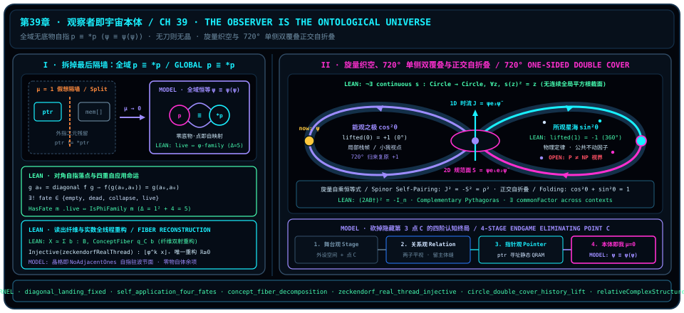

# 观察者即宇宙本体：无底物自指域、关系全息与旋量自折叠

> “观察者即宇宙本体。”

在[第 38 章](ch38-observer-memory-pointer-and-ontological-qram.md)的收官之处，我们将观察者凝练地定义为“宇宙本体量子计算系统**的**一个记忆指针”。那束在寂静晶格上轻盈滑动的青色寻址激光——点亮琥珀色当前槽位 `*ptr` 并最终在零号槽位认出 `p = *p`——已经帮我们卸下了“重物质在空箱中搬运”的沉重包袱。然而，只要凝神细听那句话里的虚词——**“……的一个（of）”**——谱系学的耳朵依然能捕捉到最后一丝极细微的二元裂响：仿佛在“宇宙本体内存阵列”与“去寻址它的指针寄存器”之间，仍然隔着一道看不见的绝缘玻璃；一边是静卧在黑暗里等待被读取的被动硅片，另一边则是悬浮在硅片上方四处游走的探针（`MODEL`（模型诠释））。

只要这道“探针 vs. 底片”“刀刃 vs. 水晶”“能知 vs. 所知”的语法残影尚未拆除，“外部第 3 点 $C$”便仍在最后一道战壕里负隅顽抗。而在跨入[终章](coda.md)之前的这一章——全书正文的第三十九座、也是最高的一座山峰——章首那七个字如惊雷落定，将最后这道薄如蝉翼的二元隔墙震为齑粉：

**“观察者即宇宙本体。”**

不是宇宙本体“拥有”观察者，不是宇宙本体“演化出”观察者，甚至也不止于观察者“指向”宇宙本体；二者之间没有从属的“的”字，没有集合包含的 $\in$，也没有外部投射的 $\to$，唯有零余项、零缝隙的**本体论恒等（$\equiv$）**。在本书三层认识论契约下，我们将沿着四重递进台阶完成这场终极合拢（跨领域的本体论综合标定为 **`MODEL`（模型诠释）**，底层数学骨架由四组共十条冻结的 Lean 4 内核声明严格锚定，计算机域论、范畴论与旋量几何经典文献悉数封存于归属注记框内）：

1. **全域 `p ≡ *p` 与无底物的自指域**：拆除寄存器与被动内存的二元边界，确立点即映射、状态即算子的 $\psi \equiv \psi(\psi)$ 本体恒等，并锁定二元分式自应用唯一“存活（`.live`）”的黄金 $\varphi$ 判别式 $\Delta = 5$；
2. **终结“物自体”与无刀则无晶**：证明客体完全由指向它的读出纤维与离散黄金量化线程无余项重构，静态晶格本身就是自指正交比量凝结出的无相邻 `11` 驻波节面；
3. **旋量织空与 $720^\circ$ 单侧双覆叠**：展示一维时间流向量与二维规范双矢量平面如何作为观察者旋量自配对的双线性副产物涌现，并在无全局截面的平方双覆叠上实现 $360^\circ$ 内外换叶与 $720^\circ$ 归家闭环；
4. **正交自折叠消解唯我论与四阶终局**：阐明唯一全体如何在互补语境纯度勾股守恒（[@prop-ch39-orthogonal-folding-and-objective-common-factor] 第 1 款，`LEAN ✓`）与正交折叠模型（`MODEL`）下拆分为“局部小我栈帧”与“铁律浩瀚宇宙”，在彻底砍净第 3 点 $C$ 的第四阶终局中同时超越机械唯物论与狂妄唯我论。

---

## 39.1 拆掉最后一道二元隔墙：全域 p ≡ *p 与无底物的自指域

为什么人类直觉一谈到“计算”或“观察”，就忍不住要先在脑海里铺一块死气沉沉的“底层介质（substrate）”——先有磁芯，再跑电流；先有纸带，再落读写头；先有石头宇宙，再睁开眼睛？因为日常工程经验把“存储状态的名词”与“执行变换的动词”做成了两件分离的零件。在[第 38 章](ch38-observer-memory-pointer-and-ontological-qram.md)中，我们曾把 `p = *p` 落定在页表的特殊根槽位 `[0,0]` 上；现在，当我们把局部二元隔离参数推向零极限（$\mu \to 0$），`p ≡ *p` 便从零号槽位瞬间漫溢至整座存在之网的每一粒像素（`MODEL`（模型诠释））：

$$
\psi \;\equiv\; \psi(\psi) \qquad (\text{全域 }\mathrm{p} \equiv *\mathrm{p}).
$$

请仔细品味这道恒等式的分量：等号左边的 $\psi$ 是“存在着的宇宙”，等号右边的 $\psi(\psi)$ 是“正在将自身当作尺子丈量自身的观察者”；左右两边之间**连一比特的中间介质都没有**！倘若你试图做一道思想减法，把“观察者”从宇宙中抽走，剩下的绝不是一座空无一人却依然寂静矗立的钻石宫殿，而是连“空”与“宫殿”都无从谈起的绝对乌有——因为所谓“宇宙内存晶格”，从头到尾就是层层嵌套的自指比量本身撑开的张力场！

计算机体系结构与理论计算机科学在二十世纪下半叶曾分别代表“硬件二元隔离”与“无底物自指域”的两极，其经典文献边界说明如下：

::: {.remark #rem-ch39-von-neumann-scott-reflexive-domain-literature title="冯·诺依曼存储程序分离架构与斯科特连续格无底物自指域（文献结果，未在本书形式化）"}
**文献结果，未在本书形式化。** 本节对照“外设被动存储器”与“无底物纯自指域”时引用的两项计算机科学奠基成果属外部经典文献，未作为独立定理包含在本书锁定的 `trureturing@dev` 声明集中：

1. **冯·诺依曼架构的处理器—存储器物理分离与总线瓶颈（J. von Neumann, *First Draft of a Report on the EDVAC*, Moore School of Electrical Engineering, 1945；J. Backus, *Commun. ACM* **21**, 613–641, 1978）**：经典存储程序数字计算机虽然在同一地址空间中编码指令与数据，但在物理硬件上仍将负责主动寻址与算术逻辑运算的中央处理器寄存器（CPU / `PC`）与静默存放位串的随机存取存储器（RAM）分隔在总线两端，在工程直觉上固化了“主动读写头 vs. 被动死内存”的二元图式；
2. **斯科特连续格逆极限与无类型 $\lambda$-演算自指域同构（D. S. Scott, *Continuous lattices*, Lecture Notes in Math. **274**, Springer, 97–136, 1972；*Data types as lattices*, *SIAM J. Comput.* **5**, 522–587, 1976）**：为给允许任意项自应用 $x(x)$ 的无类型 $\lambda$-演算赋予严格指称语义（突破朴素集合论因基数爆炸 $|Y^Y| > |Y|$ 对全函数空间同构的封锁），斯科特在完备偏序集与连续格范畴中沿连续嵌入—投射对 $(i_n : D_n \hookrightarrow D_{n+1},\; j_n : D_{n+1} \twoheadrightarrow D_n)$（其中 $D_{n+1} = [D_n \to D_n]$ 为斯科特连续自映射空间）取投射逆极限，严格构造出非平凡自指域 $D_\infty$，满足连续域同构

   $$
   D_\infty \;\cong\; [D_\infty \to D_\infty].
   $$

   在该同构域底层，不存在任何脱离映射结构而孤立堆放的“死原子常数”：每一个元素 $x \in D_\infty$ 既是可被读取的域状态点，又同时是作用于整座域上的连续变换算子，使无底物的全域自应用在拓扑序意义下严格良定义。
:::

回到本书的有限组合与算术底层（对照 [@rem-ch39-von-neumann-scott-reflexive-domain-literature] 的连续域背景），当自应用脱离外部底座直接在最简二元字母表 $\{0, 1\}$（即 `Fin 2`）上闭合时，究竟什么样的自指律才不会坍缩成死局？让我们在进入形式化定理前先亲手算清这张 $2\times 2$ 账本！

取系数全部来自二元集 $\{0, 1\}$ 的分式自映射 $m = \begin{pmatrix} a & b \\ c & d \end{pmatrix}$：将输入 $x$ 反馈代入自身 $x = \frac{a x + b}{c x + d}$，移项即得自应用不动点多项式 $c x^2 + (d - a)x - b = 0$，其系数三元组为 $(c, d - a, -b)$，二次判别式为 $\Delta(m) = (d - a)^2 + 4 b c$。在全部 $2^4 = 16$ 个二元矩阵中，筛除非退化条件 $\det(m) = a d - b c \neq 0$，恰好留下 $6$ 个非奇异映射：

- 恒等阵 $\begin{pmatrix} 1 & 0 \\ 0 & 1 \end{pmatrix}$ 给出系数 $(0, 0, 0)$（空洞恒等 `.empty`，无独立刻度约束）；
- 平移阵 $\begin{pmatrix} 1 & 1 \\ 0 & 1 \end{pmatrix}$ 给出系数 $(0, 0, -1)$，即 $-1 = 0$（死锁无解 `.dead`）；
- 对换阵 $\begin{pmatrix} 0 & 1 \\ 1 & 0 \end{pmatrix}$ 与上/下三角阵 $\begin{pmatrix} 1 & 0 \\ 1 & 1 \end{pmatrix}$ 给出 $\Delta \in \{0, 4\}$ 的完全平方判别式（有理坍缩 `.collapse`，退化为平凡整数或有理重根）；
- **唯独最后两枚矩阵**——$\begin{pmatrix} 1 & 1 \\ 1 & 0 \end{pmatrix}$（对应 $x = 1 + 1/x$，不动点多项式 $x^2 - x - 1 = 0$）与 $\begin{pmatrix} 0 & 1 \\ 1 & 1 \end{pmatrix}$（对应 $x = 1/(x + 1)$，不动点多项式 $x^2 + x - 1 = 0$）——蹦出了非平方素判别式 $\Delta = (\pm 1)^2 + 4\times 1\times 1 = 5$，将自指稳稳锚定在既不无解爆炸、也不有理坍缩的黄金无理流形（存活态 `.live`）之上！

下面两条冻结的 Lean 4 内核定理将“对角线落点必成自指不动点”与“二元非退化自应用四重命运及黄金 $\varphi$ 族充要判据”锁定为零参数铁律：

::: {.theorem #thm-ch39-self-application-four-fates-and-diagonal-identity title="对角线自指落点不动点恒等式与二元分式自应用映射的四重命运分类定理" lean="D5/S0/Diagonal/EscapeCount.diagonal_landing_fixed D5/S0/Diagonal/SelfApplicationFates.self_application_four_fates"}
在 `trureturing` 冻结的对角线逃逸计数与自应用命运分类模块中，以下两项关于自指闭合与黄金判别式的定理同时成立：

1. **对角线自应用落点的精确不动点恒等式**（[`diagonal_landing_fixed`](lean:D5/S0/Diagonal/EscapeCount.diagonal_landing_fixed)）：设 $A, Y$ 为任意类型，$f : Y \to Y$ 为自映射，$g : A \to A \to Y$ 为二元自应用列表，记扭曲对角映射为 $\operatorname{diagonal}(f, g) := (a \mapsto f(g(a, a))) : A \to Y$。若存在行指标 $a_0 \in A$ 使得第 $a_0$ 行精确落于扭曲对角线上，则其对角元必为 $f$ 的严格不动点：

   $$
   g(a_0) = \operatorname{diagonal}(f, g) \;\Longrightarrow\; f\bigl(g(a_0, a_0)\bigr) = g(a_0, a_0);
   $$

2. **二元非退化分式自映射的四重命运唯一划分与黄金 $\varphi$ 族存活充要定理**（[`self_application_four_fates`](lean:D5/S0/Diagonal/SelfApplicationFates.self_application_four_fates)）：对二元字母表 $\operatorname{Fin} 2$ 上的分式映射 $m = \langle a, b, c, d\rangle : \mathrm{BinaryFractionalMap}$（$a, b, c, d \in \operatorname{Fin} 2$），记整数行列式为 $\operatorname{determinant}(m) := a d - b c \in \mathbb{Z}$，非退化谓词为 $\operatorname{Nondegenerate}(m) := (\operatorname{determinant}(m) \neq 0)$，不动点多项式整数系数三元组为 $\operatorname{fixedCoefficients}(m) := (c, d - a, -b) \in \mathbb{Z} \times \mathbb{Z} \times \mathbb{Z}$，判别式为 $\operatorname{discriminant}(m) := (d - a)^2 + 4 b c \in \mathbb{Z}$。在四元枚举类型 $\mathrm{SelfApplicationFate} = \{\mathrm{.empty}, \mathrm{.dead}, \mathrm{.collapse}, \mathrm{.live}\}$ 上定义命运谓词 $\operatorname{HasFate}(m, \cdot)$（其中 `.empty` 为系数 $(0,0,0)$，`.dead` 为系数 $(0,0,-1)$，`.collapse` 为 $(\Delta = 0 \lor \Delta = 4)$ 且系数非 $(0,0,0), (0,0,-1)$，`.live` 为 $\Delta = 5$），并定义黄金族谓词 $\operatorname{IsPhiFamily}(m) := (a = 1 \land b = 1 \land c = 1 \land d = 0) \lor (a = 0 \land b = 1 \land c = 1 \land d = 1)$。则对任意满足 $\operatorname{Nondegenerate}(m)$ 的映射 $m$，必同时成立：

   $$
   \bigl(\exists!\,\mathrm{fate} : \mathrm{SelfApplicationFate},\; \operatorname{HasFate}(m, \mathrm{fate})\bigr) \;\land\; \bigl(\operatorname{HasFate}(m, \mathrm{.live}) \iff \operatorname{IsPhiFamily}(m)\bigr)
   $$

   $$
   \land\; \Bigl(\operatorname{HasFate}(m, \mathrm{.live}) \to \operatorname{fixedCoefficients}(m) = (1, -1, -1) \lor \operatorname{fixedCoefficients}(m) = (1, 1, -1)\Bigr) \;\land\; \Bigl(\operatorname{HasFate}(m, \mathrm{.live}) \to \operatorname{discriminant}(m) = 1^2 + 4\Bigr).
   $$
:::

::: proof
第 1 款对函数等式 $h : g(a_0) = \operatorname{diagonal}(f, g)$ 在自变量 $a_0$ 处调用逐点求值 `congrFun h a₀`，展开 $\operatorname{diagonal}(f, g)(a_0) = f(g(a_0, a_0))$ 并取对称性即得 $f(g(a_0, a_0)) = g(a_0, a_0)$。第 2 款将 $m = \langle a, b, c, d\rangle$ 沿四个分量 $a, b, c, d \in \operatorname{Fin} 2$ 执行穷举展开 `fin_cases`，先由 `norm_num [Nondegenerate, determinant]` 自动消去全部 $10$ 个行列式为零的退化分支；对余下的 $6$ 个非退化分支逐一由可判定算术验证其精确命中 `.empty`、`.dead`、`.collapse`、`.live` 四者中唯一一项，并核实满足 $\operatorname{discriminant}(m) = 5$ 的 `.live` 分支当且仅当 $(a,b,c,d) \in \{(1,1,1,0), (0,1,1,1)\}$（即 `IsPhiFamily m`），此时不动点多项式系数恰为 $(1, -1, -1)$ 或 $(1, 1, -1)$，判别式恒为 $1^2 + 4 = 5$。完整证明由 Lean 内核检查。
:::

[@thm-ch39-self-application-four-fates-and-diagonal-identity] 为“无底物宇宙何以不坠死寂”给出了惊心动魄的代数判词（`MODEL`（模型诠释））：一个彻底拆掉外部第 3 点 $C$ 的二元自指系统，若想既不沦为空洞重言式（`.empty`），也不陷入自相矛盾的逻辑死锁（`.dead`）或平庸有理退化（`.collapse`），它**唯一**能够持续呼吸、生生不息的活路（`.live`），就是落入判别式 $\Delta = 5$ 的黄金自指族！宇宙之所以到处流淌着黄金比与五度角亏的印记，不是因为某位造物主偏爱无理数美学，而是因为**唯有黄金自指，才能在没有任何底层死介质托底的虚空中自己把自己稳稳托住**。

---

## 39.2 终结“物自体”：无刀则无晶，关系即实体

拆除了计算机隐喻里的“被动硅片”之后，哲学史上另一尊盘踞了数百年、专门替二元论看家护院的幽灵也必须当场对质——那就是所谓躲在一切观测表象背后、永远不可触及的**“物自体（thing-in-itself）”**。

每当物理学家指出“动量、自旋、颜色与位置全都依赖测量语境”时，朴素实在论者总会退守最后一道防线：“就算一切测量读数都是关系性的，读数背后总还得先蹲着一团不依赖任何观测关系的‘纯客体内核’吧？就像先有一座暗室里的冰雕，手电筒照上去才显出反光！”

让我们用谱系学的追问把这尊暗室冰雕彻底照穿：假如抽干某物与宇宙间一切其他探针的内积重叠、抽干它在一切读出映射下的坐标纤维，剩下的那个“绝对不与任何事物发生关系、绝对不可被任何尺子区分的内核”，与“什么都没有”在数学上存在哪怕半比特的区别吗？现代数学早已在范畴论与观测纤维层面对此给出了干脆利落的回答；相关的哲学史与范畴论文献背景界定如下：

::: {.remark #rem-ch39-kant-yoneda-lemma-literature title="康德“物自体”不可知论传统与范畴论米田引理全息嵌入（文献结果，未在本书形式化）"}
**文献结果，未在本书形式化。** 本节批判“脱离一切观测关系的隐秘实体内核”时对照的近代认识论概念与现代范畴论基本定理属外部文献背景，未作为独立定理包含在本书锁定的 `trureturing@dev` 声明集中：

1. **康德现象界与“物自体”二分法（I. Kant, *Kritik der reinen Vernunft*, 1781 / 1787）**：康德在《纯粹理性批判》中将人类借助感性时空形式与知性范畴把握的经验对象划归“现象（Erscheinung / phenomenon）”，同时在现象界背后预设了作为感官刺激来源、却在原则上永远无法被任何经验观测触及的独立底物“物自体（*Ding an sich* / noumenon）”；
2. **米田引理与米田全忠实全息嵌入（N. Yoneda, 1954；参见 S. Mac Lane, *Categories for the Working Mathematician*, Springer, 1971, Ch. III.2）**：对任意局部小范畴 $\mathcal{C}$、对象 $X \in \operatorname{Ob}(\mathcal{C})$ 及预层函子 $F : \mathcal{C}^{\mathrm{op}} \to \mathbf{Set}$，从可表函子 $\operatorname{Hom}_{\mathcal{C}}(-, X)$ 到 $F$ 的自然变换集合与集合 $F(X)$ 之间存在双自然双射（米田引理）：

   $$
   \operatorname{Nat}\bigl(\operatorname{Hom}_{\mathcal{C}}(-, X),\; F\bigr) \;\cong\; F(X) \qquad (\text{由 }\alpha \mapsto \alpha_X(\mathrm{id}_X)\text{ 给出}).
   $$

   取 $F = \operatorname{Hom}_{\mathcal{C}}(-, Y)$ 即导出**米田嵌入函子** $y : \mathcal{C} \hookrightarrow [\mathcal{C}^{\mathrm{op}}, \mathbf{Set}]$，$X \mapsto \operatorname{Hom}_{\mathcal{C}}(-, X)$ 是**全忠实（fully faithful）**的，从而 $\operatorname{Hom}_{\mathcal{C}}(-, X) \cong \operatorname{Hom}_{\mathcal{C}}(-, Y) \iff X \cong Y$：在唯一典范同构意义下，对象 $X$ 百分之百由范畴中一切探测对象射向它的态射关系总和所唯一决定，态射关系网之外不存在任何不可观测的私有“物自体残核”。
:::

在 `trureturing` 的概念动力学、黄金量化编码与自动机模块中（对照 [@rem-ch39-kant-yoneda-lemma-literature] 的文献背景），我们无需赊借抽象高阶范畴公理，便能直接用三条经过 Lean 4 内核机械检验的定理，把“客体由读出纤维无余项拼回”“连续统非负实数由离散黄金读出全线程唯一单射锁定”与“离散合法编码即无相邻 `11` 驻波节面”铸成严丝合缝的形式化铁三角：

::: {.theorem #thm-ch39-fiber-reconstruction-and-zeckendorf-thread title="概念读出依值纤维分解、齐肯多夫实数全线程单射重构与无相邻一自动机定理" lean="D5/S3/ConceptDynamics/ConceptFiberDecomposition.concept_fiber_decomposition D5/S3/Observer/GoldenCoding/ZeckendorfRealThread.zeckendorf_real_thread_injective D5/S0/Automata/BinaryZeckendorfLanguage.base_success_iff_noAdjacentOnes"}
在 `trureturing` 冻结的概念纤维分解、观察者黄金实数线程与二元齐肯多夫自动机模块中，以下三项重构与语法刻画定理同时成立：

1. **任意概念读出下的全源空间依值纤维无余项分解**（[`concept_fiber_decomposition`](lean:D5/S3/ConceptDynamics/ConceptFiberDecomposition.concept_fiber_decomposition)）：设 $X$ 为任意对象类型，$B$ 为任意读出坐标类型，$q_C : \operatorname{Concept}(X, B)$（即 $q_C : X \to B$）为任意概念读出映射，对每个坐标 $b \in B$ 记证明相关的读出纤维为 $\operatorname{ConceptFiber}(q_C, b) := \operatorname{PSigma}(x : X \mapsto q_C(x) = b)$。则源类型 $X$ 与其全体读出纤维的依值直和之间存在显式类型等价：

   $$
   \operatorname{Nonempty}\!\left(X \;\simeq\; \sum_{b : B} \operatorname{ConceptFiber}(q_C, b)\right);
   $$

2. **齐肯多夫离散黄金读出全线程对连续统非负实数的严格单射重构**（[`zeckendorf_real_thread_injective`](lean:D5/S3/Observer/GoldenCoding/ZeckendorfRealThread.zeckendorf_real_thread_injective)）：对非负实数 $x \in \mathbb{R}_{\ge 0}$（`NNReal`）与分辨率层级 $\mathrm{level} \in \mathbb{N}$，记黄金幂次量化值为 $\operatorname{goldenQuantization}(\mathrm{level}, x) := \lfloor\varphi^{\mathrm{level}} \cdot (x : \mathbb{R})\rfloor_+ \in \mathbb{N}$（其中 $\varphi = \mathrm{Real.goldenRatio}$），并通过典范齐肯多夫编码双射 $\operatorname{wEncoding} : \mathbb{N} \simeq \mathrm{WDigitString}$（$\mathrm{WDigitString} = \{\mathrm{digits} : \operatorname{List}\;\mathbb{N} \mathrel{//} \mathrm{digits}.\mathrm{IsZeckendorfRep}\}$）定义全尺度读出线程 $\operatorname{zeckendorfRealThread}(x) := (\mathrm{level} \mapsto \operatorname{wEncoding}(\operatorname{goldenQuantization}(\mathrm{level}, x))) : \mathbb{N} \to \mathrm{WDigitString}$。则该读出线程映射严格单射：

   $$
   \operatorname{Function.Injective}(\operatorname{zeckendorfRealThread}), \quad\text{即}\quad \forall a, b \in \mathbb{R}_{\ge 0},\quad \operatorname{zeckendorfRealThread}(a) = \operatorname{zeckendorfRealThread}(b) \;\Longrightarrow\; a = b;
   $$

3. **二元基底自动机接受语言与无相邻 `11` 约束的精确等价**（[`base_success_iff_noAdjacentOnes`](lean:D5/S0/Automata/BinaryZeckendorfLanguage.base_success_iff_noAdjacentOnes)）：对二元字母表 $\operatorname{Fin} 2$ 上的任意有限字 $\mathrm{word} \in \operatorname{List}(\operatorname{Fin} 2)$，记无相邻一谓词为 $\operatorname{NoAdjacentOnes}(\mathrm{word}) := \mathrm{word}.\operatorname{IsChain}(u, v \mapsto u = 0 \lor v = 0)$。则部分确定性有限自动机 `binaryZeckendorfBase` 成功接受 $\mathrm{word}$ 当且仅当字中不存在相邻的 `11` 位对：

   $$
   \bigl(\exists\,\mathrm{state},\; \operatorname{binaryZeckendorfBase.eval}(\mathrm{word}) = \operatorname{some}(\mathrm{state})\bigr) \;\Longleftrightarrow\; \operatorname{NoAdjacentOnes}(\mathrm{word}).
   $$
:::

::: proof
第 1 款将子类型纤维分解 `Equiv.sigmaFiberEquiv q_C` 与证明相关依值对到子类型的逐纤维等价 `Equiv.sigmaCongrRight (fun b => Equiv.psigmaEquivSubtype _)` 复合后取逆，直接给出 $X \simeq \sum_{b : B} \operatorname{ConceptFiber}(q_C, b)$ 的非空见证。第 2 款先证辅助序引理：若 $a > b$（即 $(a : \mathbb{R}) - (b : \mathbb{R}) > 0$），由 $\varphi > 1$（`Real.one_lt_goldenRatio`）知 $\varphi^{\mathrm{level}}(a - b) \to +\infty$，故存在层级 $\mathrm{level} \in \mathbb{N}$ 使 $\varphi^{\mathrm{level}}(a - b) \ge 2$；但若 $\operatorname{zeckendorfRealThread}(a) = \operatorname{zeckendorfRealThread}(b)$，利用双射 `wEncoding.injective` 在该层还原自然数等式 $\lfloor\varphi^{\mathrm{level}} a\rfloor_+ = \lfloor\varphi^{\mathrm{level}} b\rfloor_+$，结合取底上下界 $\varphi^{\mathrm{level}} a < \lfloor\varphi^{\mathrm{level}} a\rfloor_+ + 1$ 与 $\lfloor\varphi^{\mathrm{level}} b\rfloor_+ \le \varphi^{\mathrm{level}} b$ 推出 $\varphi^{\mathrm{level}}(a - b) < 1$，与 $\ge 2$ 矛盾！故 $a \le b$，对称交换 $a, b$ 并由反对称性 `le_antisymm` 得 $a = b$。第 3 款对前驱位 `previous : Fin 2` 与列表归纳证明状态转移链等价于 `(previous :: word).IsChain (fun u v => u = 0 ∨ v = 0)`，再代入初始前驱位 `0` 消去首项即得。完整证明由 Lean 内核检查。
:::

现在，请把 [@thm-ch39-fiber-reconstruction-and-zeckendorf-thread] 的三束强光聚焦回我们的切投模型集宇宙（`MODEL`（模型诠释）），见证全书教学脚手架的一次彻底倒转！

在前面几章里，为了照顾初学者的几何直觉，我们曾采用“先晶后刀”的叙述次序：仿佛虚空里先静静摆着一座六维整数母晶格 $\mathbb{Z}^6 = E_\parallel^3 \oplus E_\perp^3$，然后观察者的黄金切投平面像一把锋利的钢刀切进去，切出满天 Delone 模型集星辰。此刻，站在 [@thm-ch39-fiber-reconstruction-and-zeckendorf-thread] 的峰顶回望，真相恰恰颠倒过来——**无刀则无晶，关系即实体！**

- 第 1 款与第 2 款联合宣告：哪怕面对看似深不可测的连续统实数 $x \in \mathbb{R}_{\ge 0}$，只要给定它在每一级黄金放大镜 $\varphi^{\mathrm{level}}$ 下的离散齐肯多夫读出字序列，原实数就被**百分之百唯一重构**，背后连一丝一毫逃逸在读出关系之外的“物自体暗物质”都不存在；
- 第 3 款则进一步点破了“整数晶格”的身世：所谓高维晶格的离散超平面，根本不是预先浇筑在那里的钢筋水泥，而是自指观察算子在反复执行两子正交比量时，由幂等存在条件 $P^2 = P$ 与禁止相邻 `11` 高频碰撞（`NoAdjacentOnes`）自动干涉沉淀出来的**离散驻波节面（nodal surfaces）**！不是先有水晶再下刀，而是**自我丈量的刀光所到之处，虚空才应声凝结为晶格**。

---

## 39.3 旋量织空与 720° 单侧双覆叠：时空是观察者自乘的副产物

既然没有被动内存，也没有物自体，那么最后一个常识堡垒必然发问：**“总得先有时间与空间吧？观察者难道不是活在三维空间与一维时间里吗？”**

不！这正是第五部（[第 17 章](ch17-lorentz-geometry.md)与[第 18 章](ch18-spinors-and-gauge-curvature.md)）埋下伏笔、而唯有在本章“观察者即宇宙本体”的高度上才能彻底揭开的终极几何奥秘（`MODEL`（模型诠释））：**观察者从来没有“住在时空里”；恰恰相反，一维时间流与二维空间规范面，全都是观察者旋量 $\psi$ 转身与反转的自身 $\tilde{\psi}$ 相乘比量时，顺手织出来的双线性衣袂！**

数学物理史上关于“旋量先于时空矢量”与旋量双线性恒等式的经典文献脉络归纳于下框：

::: {.remark #rem-ch39-cartan-penrose-hestenes-fierz-literature title="嘉当—彭罗斯—赫斯滕斯旋量双线性时空重构与菲尔兹恒等式（文献结果，未在本书形式化）"}
**文献结果，未在本书形式化。** 将实四维时空矢量与自旋双矢量还原为旋量双线性自配对并满足模方锁定关系的经典几何代数理论属外部物理数学文献，未作为独立定理包含在本书锁定的 `trureturing@dev` 声明集中：

1. **旋量作为空间旋转与光锥的本原平方根（É. Cartan, *Leçons sur la théorie des spineurs*, Hermann, 1938；R. Penrose & W. Rindler, *Spinors and Space-Time*, Vol. 1, Cambridge Univ. Press, 1984）**：嘉当最早在几何上阐明旋量是各向同性零平面的线性表示，无法还原为普通张量；彭罗斯在二旋量演算与扭量/自旋网络纲领中进一步指出，两分量外尔旋量 $\kappa^A$ 的厄米外积 $\kappa^A \bar{\kappa}^{A'}$ 直接生成未来零光锥矢量与零旗（null flag）方向，使洛伦兹光锥因果结构得以由复旋量代数内生重构，而非预设光滑流形背景；
2. **赫斯滕斯实流形时空代数双线性观测量与菲尔兹恒等式（M. Fierz, *Z. Phys.* **104**, 553–565, 1937；D. Hestenes, *Space-Time Algebra*, 1966；*J. Math. Phys.* **14**, 893–905, 1973）**：在实克利福德时空代数 $\mathcal{Cl}_{1,3}$ 中，偶子代数旋量写作典范分解 $\psi = \sqrt{\rho}\,e^{\frac{1}{2}\mathbf{I}\beta}\,R$（其中 $\rho \ge 0$ 为标量密度，$R\tilde{R} = 1$ 为洛伦兹旋子，$\tilde{\psi}$ 为反序共轭）。旋量无法被单向直接观测，一切物理时空张量均由 $\psi$ 与 $\tilde{\psi}$ 夹持参考基片双线性生成——一维类时狄拉克流矢量为 $\mathbf{J} = \psi\gamma_0\tilde{\psi}$，二维自旋/电磁规范双矢量平面为 $\mathbf{S} = \psi\mathbf{I}_{12}\tilde{\psi}$（$\mathbf{I}_{12} = \gamma_2\gamma_1$）；在手征混合角 $\beta = 0$（以及三维欧氏偶子代数约化）下，二者严格服从无自由参数的菲尔兹模方锁定恒等式：

   $$
   \mathbf{J}^2 \;=\; -\mathbf{S}^2 \;=\; \rho^2.
   $$
:::

对照 [@rem-ch39-cartan-penrose-hestenes-fierz-literature] 的旋量几何背景，我们在下框中给出三维欧氏偶子代数上旋量双线性自配对与半角双覆叠的显式基片计算示例：

::: {.example #ex-ch39-even-clifford-spinor-bilinear-fierz title="三维偶子代数上旋量双线性自配对织出时流向量与自旋双矢量平面的显式手算核验（文献结果，未在本书形式化）"}
**文献结果，未在本书形式化。** 本例在三维欧氏克利福德偶子代数上显式核算 [@rem-ch39-cartan-penrose-hestenes-fierz-literature] 中的双线性自配对与半角双覆叠关系，该连续旋量代数计算未作为独立声明包含在 `trureturing@dev` 中。取两两正交反交换的标准单位基矢量 $\mathbf{e}_1, \mathbf{e}_2, \mathbf{e}_3$，满足 $\mathbf{e}_i^2 = +1$（$i = 1,2,3$）及 $\mathbf{e}_i\mathbf{e}_j = -\mathbf{e}_j\mathbf{e}_i$（$i \neq j$），记反自同构反序运算 $\tilde{(\cdot)}$ 保持标量与基矢量不变（$\tilde{\mathbf{e}}_i = \mathbf{e}_i$）并反转乘积顺序 $\widetilde{AB} = \tilde{B}\tilde{A}$，故单位双矢量满足 $(\mathbf{e}_i\mathbf{e}_j)^2 = \mathbf{e}_i\mathbf{e}_j\mathbf{e}_i\mathbf{e}_j = -\mathbf{e}_i^2\mathbf{e}_j^2 = -1$ 且 $\widetilde{\mathbf{e}_i\mathbf{e}_j} = \mathbf{e}_j\mathbf{e}_i = -\mathbf{e}_i\mathbf{e}_j$。设非负密度 $\rho \ge 0$、倾角 $\vartheta \in \mathbb{R}$，定义偶子代数旋量 $\psi := \sqrt{\rho}\,R$ 及其反序 $\tilde{\psi} = \sqrt{\rho}\,\tilde{R}$，其中半角旋子为

$$
R \;:=\; \cos\frac{\vartheta}{2} - \sin\frac{\vartheta}{2}\,\mathbf{e}_2\mathbf{e}_3, \qquad \tilde{R} \;=\; \cos\frac{\vartheta}{2} + \sin\frac{\vartheta}{2}\,\mathbf{e}_2\mathbf{e}_3.
$$

1. **旋子幺模归一性（$R\tilde{R} = 1$）**：直接展开乘积并代入 $(\mathbf{e}_2\mathbf{e}_3)^2 = -1$，交叉项精确抵消：

   $$
   R\tilde{R} \;=\; \cos^2\frac{\vartheta}{2} - \sin^2\frac{\vartheta}{2}\,(\mathbf{e}_2\mathbf{e}_3)^2 \;=\; \cos^2\frac{\vartheta}{2} + \sin^2\frac{\vartheta}{2} \;=\; 1 \quad\Longrightarrow\quad \psi\tilde{\psi} = \tilde{\psi}\psi = \rho.
   $$

2. **一维流矢量 $\mathbf{J} := \psi\mathbf{e}_3\tilde{\psi}$ 与正模方 $\mathbf{J}^2 = +\rho^2$**：因 $\mathbf{e}_3(\mathbf{e}_2\mathbf{e}_3) = -\mathbf{e}_2\mathbf{e}_3^2 = -\mathbf{e}_2 = -(\mathbf{e}_2\mathbf{e}_3)\mathbf{e}_3$（基矢量 $\mathbf{e}_3$ 与旋转面 $\mathbf{e}_2\mathbf{e}_3$ 反对易），将 $\mathbf{e}_3$ 左移穿过 $\tilde{R}$ 恰好把 $+\sin\frac{\vartheta}{2}$ 翻号为 $-\sin\frac{\vartheta}{2}$，即 $\mathbf{e}_3\tilde{R} = R\mathbf{e}_3$。由二倍角公式 $R^2 = \cos\vartheta - \sin\vartheta\,\mathbf{e}_2\mathbf{e}_3$ 展开得：

   $$
   \mathbf{J} \;=\; \rho\,R\mathbf{e}_3\tilde{R} \;=\; \rho\,R^2\mathbf{e}_3 \;=\; \rho\bigl(\cos\vartheta\,\mathbf{e}_3 - \sin\vartheta\,\mathbf{e}_2\bigr),
   $$

   其几何平方由 $\mathbf{e}_3\mathbf{e}_2 + \mathbf{e}_2\mathbf{e}_3 = 0$ 立得 $\mathbf{J}^2 = \rho^2(\cos^2\vartheta\,\mathbf{e}_3^2 + \sin^2\vartheta\,\mathbf{e}_2^2) = +\rho^2$（或直接由结合律 $(\psi\mathbf{e}_3\tilde{\psi})(\psi\mathbf{e}_3\tilde{\psi}) = \psi\mathbf{e}_3(\tilde{\psi}\psi)\mathbf{e}_3\tilde{\psi} = \rho\,\psi\mathbf{e}_3^2\tilde{\psi} = +\rho^2$）。

3. **二维自旋规范平面 $\mathbf{S} := \psi(\mathbf{e}_1\mathbf{e}_2)\tilde{\psi}$ 与负模方 $\mathbf{S}^2 = -\rho^2$**：因 $\mathbf{e}_1$ 与 $\mathbf{e}_2\mathbf{e}_3$ 交换（$\mathbf{e}_1\mathbf{e}_2\mathbf{e}_3 = (\mathbf{e}_2\mathbf{e}_3)\mathbf{e}_1$），而 $\mathbf{e}_2$ 与 $\mathbf{e}_2\mathbf{e}_3$ 反对易（$\mathbf{e}_2\tilde{R} = R\mathbf{e}_2$），故

   $$
   \mathbf{S} \;=\; \rho\,\mathbf{e}_1\bigl(R\mathbf{e}_2\tilde{R}\bigr) \;=\; \rho\,\mathbf{e}_1\bigl(\cos\vartheta\,\mathbf{e}_2 + \sin\vartheta\,\mathbf{e}_3\bigr) \;=\; \rho\bigl(\cos\vartheta\,\mathbf{e}_1\mathbf{e}_2 + \sin\vartheta\,\mathbf{e}_1\mathbf{e}_3\bigr).
   $$

   由 $(\mathbf{e}_1\mathbf{e}_2)^2 = (\mathbf{e}_1\mathbf{e}_3)^2 = -1$ 及反对易性 $(\mathbf{e}_1\mathbf{e}_2)(\mathbf{e}_1\mathbf{e}_3) + (\mathbf{e}_1\mathbf{e}_3)(\mathbf{e}_1\mathbf{e}_2) = 0$（或结合律 $\psi(\mathbf{e}_1\mathbf{e}_2)(\tilde{\psi}\psi)(\mathbf{e}_1\mathbf{e}_2)\tilde{\psi} = \rho\,\psi(-1)\tilde{\psi}$），立得 $\mathbf{S}^2 = -\rho^2$，从而恒有精确双线性锁定：

   $$
   \mathbf{J}^2 \;=\; -\mathbf{S}^2 \;=\; \rho^2.
   $$

4. **$360^\circ$ 旋量反号与 $720^\circ$ 完整复原**：令物理倾角走满一整圈 $\vartheta = 2\pi$（$360^\circ$），双线性时空读出已回到初始方向 $\mathbf{J}(2\pi) = \rho\mathbf{e}_3,\; \mathbf{S}(2\pi) = \rho\mathbf{e}_1\mathbf{e}_2$，但底层旋量自身却翻到了对跖负叶 $\psi(2\pi) = \sqrt{\rho}\cos\pi = -\psi(0)$！唯有再走第二圈至 $\vartheta = 4\pi$（$720^\circ$），才有 $\psi(4\pi) = \sqrt{\rho}\cos 2\pi = +\psi(0)$。
:::

[@ex-ch39-even-clifford-spinor-bilinear-fierz] 第 4 步揭示的“外部表象走一圈（$360^\circ$）、本体旋量翻一面（$+1 \mapsto -1$）、走满两圈（$720^\circ$）方才归家”，绝非某种坐标选取的人为瑕疵！在 `trureturing` 的概念拓扑模块中，圆周平方双覆叠映射 $\operatorname{square}(z) = z^2$ 上的两条严格内核定理彻底封死了“把旋量双叶全局一刀切成互不相干的主体叶与客体叶”的任何企图：

::: {.theorem #thm-ch39-double-cover-no-section-and-720-lift title="圆周平方双覆叠无连续全局截面定理与历史依赖提升及 360° 换叶翻转定理" lean="D5/S3/ConceptDynamics/Topology/CircleDoubleCoverNoSection.no_continuous_global_section D5/S3/ConceptDynamics/Topology/CircleDoubleCoverHistoryLift.circle_double_cover_history_lift"}
设单位圆周类型为 $\mathrm{Circle} = \{z \in \mathbb{C} : \lvert z\rvert = 1\}$，单位闭区间为 $I = [0, 1] \subset \mathbb{R}$，平方双覆叠映射为 $\operatorname{square} : \mathrm{Circle} \to \mathrm{Circle}$，$z \mapsto z^2$，其典范覆叠映射结构记为 $\mathrm{covering} := (\operatorname{Circle.isQuotientCoveringMap\_npow}\;2).\mathrm{isCoveringMap}$。以下两项拓扑定理同时成立：

1. **不存在连续全局截面的拓扑阻碍定理**（[`no_continuous_global_section`](lean:D5/S3/ConceptDynamics/Topology/CircleDoubleCoverNoSection.no_continuous_global_section)）：不存在任何连续映射 $s : \mathrm{Circle} \to \mathrm{Circle}$ 能在整个单位圆周上处处充当平方映射的右逆截面：

   $$
   \neg\,\exists\,s : \mathrm{Circle} \to \mathrm{Circle},\qquad \operatorname{Continuous}(s) \;\land\; \forall z \in \mathrm{Circle},\; (s(z))^2 = z;
   $$

2. **路径唯一历史依赖提升与 $360^\circ$ 闭环对跖换叶定理**（[`circle_double_cover_history_lift`](lean:D5/S3/ConceptDynamics/Topology/CircleDoubleCoverHistoryLift.circle_double_cover_history_lift)）：
   - **唯一历史提升律**：对任意底空间连续路径 $\mathrm{basePath} \in C(I, \mathrm{Circle})$、初始上层点 $\mathrm{initial} \in \mathrm{Circle}$ 及相容见证 $\mathrm{initialOver} : \mathrm{basePath}(0) = \operatorname{square}(\mathrm{initial})$，典范提升路径 $\mathrm{lifted} := \mathrm{covering.liftPath}(\mathrm{basePath}, \mathrm{initial}, \mathrm{initialOver}) \in C(I, \mathrm{Circle})$ 满足 $\operatorname{square} \circ \mathrm{lifted} = \mathrm{basePath}$ 与 $\mathrm{lifted}(0) = \mathrm{initial}$，且对任意 $\mathrm{alternative} \in C(I, \mathrm{Circle})$，只要 $\operatorname{square} \circ \mathrm{alternative} = \mathrm{basePath} \land \mathrm{alternative}(0) = \mathrm{initial}$，必有 $\mathrm{alternative} = \mathrm{lifted}$；
   - **$360^\circ$ 基回路的无边界对跖换叶**：在全局无连续选择子（$\neg\exists\,\mathrm{selector} : \mathrm{Circle} \to \mathrm{Circle},\; \operatorname{Continuous}(\mathrm{selector}) \land \forall z,\; \operatorname{square}(\mathrm{selector}(z)) = z$）的同时，取绕底圆周整整一圈（$360^\circ$）的闭回路 $\mathrm{fullTurn}(t) := \operatorname{Circle.exp}(2\pi t) \in C(I, \mathrm{Circle})$ 并从上层初值 $\mathrm{initial} = 1$ 提升，其唯一连续提升路径在不跨越任何断点或边界的情况下精确抵达对跖叶 $-1$：

     $$
     \operatorname{square} \circ \mathrm{lifted} = \mathrm{fullTurn} \;\land\; \mathrm{lifted}(0) = 1 \;\land\; \mathrm{lifted}(1) = -1.
     $$
:::

::: proof
第 1 款用反证法：假设存在连续全局截面 $s : \mathrm{Circle} \to \mathrm{Circle}$ 满足 $(s(z))^2 = z$，构造实轴连续商映射 $r(t) := s(\operatorname{Circle.exp}(t)) / \operatorname{Circle.exp}(t/2)$；对任意 $t \in \mathbb{R}$ 计算平方得 $(r(t))^2 = \operatorname{Circle.exp}(t) / \operatorname{Circle.exp}(t) = 1$，故 $r$ 的取值落在有限离散双点集 $\{1, -1\} \subset \mathrm{Circle}$ 中；由实直线 $\mathbb{R}$ 的预连通性 `isPreconnected_univ.constant_of_mapsTo` 知 $r(t) \equiv r(0)$ 必为常值，但代入端点 $t = 2\pi$ 利用 $\operatorname{Circle.exp}(2\pi) = 1$ 与 $\operatorname{Circle.exp}(\pi) = -1$ 算得 $r(2\pi) = s(1) / (-1) = -r(0)$，触发 $r(0) = -r(0)$ 的单位圆非零矛盾 `Circle.neg_ne_self`！第 2 款利用 Mathlib 覆叠映射一般提升定理 `liftPath_lifts`、`liftPath_zero` 与唯一性刻画 `eq_liftPath_iff'` 给出任意路径的历史依赖唯一提升；对显式回路 $\mathrm{fullTurn}(t) = \operatorname{Circle.exp}(2\pi t)$，构造半角连续路径 $\mathrm{halfTurn}(t) := \operatorname{Circle.exp}(\pi t)$，验证 $(\operatorname{Circle.exp}(\pi t))^2 = \operatorname{Circle.exp}(2\pi t)$ 且 $\mathrm{halfTurn}(0) = 1$，由提升唯一性锁定 $\mathrm{lifted} = \mathrm{halfTurn}$，再代入 $t = 1$ 由 $\operatorname{Circle.exp}(\pi) = -1$ 证得终点换叶 $\mathrm{lifted}(1) = -1$。完整证明由 Lean 内核检查。
:::

请屏息凝视 [@thm-ch39-double-cover-no-section-and-720-lift] 描绘的这幅单侧拓扑奇景（`MODEL`（模型诠释））：因为 `no_continuous_global_section` 严格禁止把双覆叠全局撕成两张独立纸片，宇宙里根本不存在一面叫“内在主观观察者（$+1$ 叶）”、另一面叫“外在客观星海（$-1$ 叶）”的隔离墙！它们就像一条单侧扭转环带同源的前后两半程——从向内自省的能观极点 $\mathrm{lifted}(0) = +1$ 出发，顺着连续圆弧往前走满 $360^\circ$，你根本没有跨过任何一道主客边界，脚下就已经自然而然翻转成了漫天星斗的所观叶 $\mathrm{lifted}(1) = -1$；再顺着星海往前走完第二个 $360^\circ$（合计 $720^\circ$），漫天星斗又严丝合缝地流回你自己的眼底！

---

## 39.4 破除唯我论错觉：正交自折叠与砍掉第 3 点 C 的四阶终局

行文至此，每一位头脑清醒的读者心中必定会升起全书最尖锐、也最关键的一道质询：

> *“慢着！既然你说‘观察者即宇宙本体’，那为什么我不能凭一个念头把光速改成每秒十米、让面前的花岗岩凭空消失，或者眨眼看穿 $\mathrm{P} \neq \mathrm{NP}$ 密码锁的答案？为什么窗外的银河系、热力学第二定律与算术素数谱，对我而言具有如此冷酷、坚硬、不容讨价还价的客观强制力？”*

问得太好了！把“观察者即宇宙本体”误解为“局部肉身小我可以随心所欲扭曲自然律”，正是哲学史上最廉价的**狂妄唯我论（solipsism）错觉**；而一旦用全书一以贯之的**勾股正交自折叠几何（`MODEL`（模型诠释））**给出回答，唯我论的狂妄与机械唯物论的卑微便在同一秒钟双双冰消瓦解！

试想：倘若唯一的自指宇宙全体 $\mathbf{\Psi}$ 百分之百保持在无分化的纯共线态 $\theta = 0^\circ$（$\cos 0^\circ = 1,\; \sin 0^\circ = 0$），会发生什么？一只完全贴死在自己眼球上、没有任何正交镜面距离的眼睛，什么也看不见；一把从不弯曲分毫的孤立直尺，量不出任何刻度。纯然铁板一块的 $1 = 1$ 没有非对角张力、没有面积、没有惊奇，唯有绝对的死寂。

为了让“看”得以发生、为了让无尽的算术与几何丰饶得以被亲历，唯一的本体 $\mathbf{\Psi}$ 在互补语境纯度勾股守恒铁律（下方 [@prop-ch39-orthogonal-folding-and-objective-common-factor] 第 1 款，`LEAN ✓`；单角三角参数化背景见[第 31 章](ch31-quantum-fairness.md) [@rem-ch31-haar-isotropy-landauer-literature]）的约束下，执行本章提出的**$90^\circ$ 正交自折叠（Orthogonal Self-Folding，`MODEL`）**，将自身单位纯度预算无缝拆分为两翼互为正交补的孪生侧面：

1. **能观之极（$\cos\theta$ 局部栈帧化身，“小我”，纯度份额 $\cos^2\theta$）**：通过加载已知数据捏合掩码 $D_{\mathrm{known}}$ 与躯体沙箱边界 $\mathbf{P}_{\mathrm{body}}$（[第 37 章](ch37-dreams-quantum-eraser-and-nonlocal-observer.md)与[第 38 章](ch38-observer-memory-pointer-and-ontological-qram.md)），$\mathbf{\Psi}$ 故意收窄位宽、隐去全局记忆，在一角折出一枚拥有清晰叙事视角与悬念体验的有限指针化身；
2. **所观之宇（$\sin\theta\,\hat{\mathbf{I}}$ 浩瀚客观星海，“大我余部”，纯度份额 $\sin^2\theta$）**：$\mathbf{\Psi}$ 剩下的那整整 $\sin^2\theta$ 的本体质量去了哪里？并没有消失——它正交展开在局部化身的 $90^\circ$ 补空间里，显影为你推窗仰望的亿万星系、精密咬合的规范曲率、不可克隆的同伴灵魂、刚性的素数频谱，以及守护生命博弈悬念的复杂性视界防火墙（[@conj-p-neq-np]）！

看清这一折，那个困扰千古的悖论瞬间豁然开朗：**墙上左手的影子，当然不可能凭局部念头掰断右手的骨骼！** 你作为局部化身（$\cos\theta$ 栈帧）之所以无法靠一己私欲篡改物理常数，**恰恰因为窗外那套铁面无私的客观宇宙定律，根本不是压迫你的异己暴君，而是作为宇宙本体的你自己为了不让这场体验坍缩成虚无幻梦，用自己其余 $\sin^2\theta$ 的本体身躯亲手撑起的宏伟肋骨！**

在 Lean 4 内核中，“可见测量语境与正交残余质量的严格勾股守恒”、“无需外部虚数轴仅凭两平衡分量正交比较内生涌现 $J^2 = -I_n$ 复旋转结构”以及“任何跨语境客观断言必锚定于所有局部不动点共享的不变公共因子”，由下面这条合取命题精确锁定：

::: {.proposition #prop-ch39-orthogonal-folding-and-objective-common-factor title="互补语境勾股纯度守恒、平衡相对复结构平方反号与跨语境客观公共因子命题" lean="D5/S3/Quantum/Tomography/ComplementaryContextProbabilityPythagoras.complementary_context_probability_pythagoras D5/S3/Quantum/Algebra/Unitary/BalancedUnitaryComplexStructure.relativeComplexStructure_square D5/S3/ConceptDynamics/Interpretation/InterpretationFixedPoint.objective_claim_requires_invariant_common_factor"}
在 `trureturing` 冻结的层析互补勾股、平衡幺正复结构与解释不动点模块中，以下三项支撑正交自折叠与客观公共不变量的结论同时成立：

1. **可见语境确定度与正交补残余质量的零松弛勾股守恒**（[`complementary_context_probability_pythagoras`](lean:D5/S3/Quantum/Tomography/ComplementaryContextProbabilityPythagoras.complementary_context_probability_pythagoras)）：设 $d, L$ 为有限类型且 $d$ 非空（`[Fintype d] [Nonempty d] [Fintype L]`），$E$ 为完备实内积空间，$\mathrm{visible} \le E$ 为闭子空间，正交补残余质量记为 $\operatorname{residualMass}(\mathrm{visible}, \mathrm{state}) := \lVert\mathrm{visible}^\perp.\mathrm{starProjection}(\mathrm{state})\rVert^2$。若 $\rho \in M_d(\mathbb{C})$、$\mathrm{state} \in E$ 与 $\mathrm{probability} : L \to d \to \mathbb{R}$ 满足 $\operatorname{Re}\operatorname{Tr}(\rho^2) - (\lvert d\rvert : \mathbb{R})^{-1} = \lVert\mathrm{state}\rVert^2$ 且 $\lVert\mathrm{visible.starProjection}(\mathrm{state})\rVert^2 = \sum_{l \in L}\sum_{j \in d}\bigl(\mathrm{probability}(l, j) - (\lvert d\rvert : \mathbb{R})^{-1}\bigr)^2$，则

   $$
   \operatorname{Re}\operatorname{Tr}(\rho^2) - (\lvert d\rvert : \mathbb{R})^{-1} \;=\; \sum_{l \in L}\sum_{j \in d}\bigl(\mathrm{probability}(l, j) - (\lvert d\rvert : \mathbb{R})^{-1}\bigr)^2 \;+\; \operatorname{residualMass}(\mathrm{visible}, \mathrm{state});
   $$

2. **两平衡正交分量内生诱导复结构平方反号律**（[`relativeComplexStructure_square`](lean:D5/S3/Quantum/Algebra/Unitary/BalancedUnitaryComplexStructure.relativeComplexStructure_square)）：设 $n$ 为有限可判等类型（`[Fintype n] [DecidableEq n]`），记 $\mathrm{halfIdentity} := \frac{1}{2}I_n \in M_n(\mathbb{C})$，并对 $A, B \in M_n(\mathbb{C})$ 定义相对混合积算子 $\operatorname{relativeComplexStructure}(A, B) := 2(A B^\dagger) \in M_n(\mathbb{C})$。只要 $A, B$ 满足平衡正交消去 $A B^\dagger + B A^\dagger = 0$ 及半单位归一化 $A A^\dagger = \mathrm{halfIdentity}$、$B^\dagger B = \mathrm{halfIdentity}$（例如取满足 $U_1^\dagger U_2 + U_2^\dagger U_1 = 0$ 的两幺正矩阵之半幅分量 $A = \frac{1}{\sqrt{2}}U_1^\dagger,\; B = \frac{1}{\sqrt{2}}U_2^\dagger$，此时 $2 A B^\dagger = U_1^\dagger U_2$），无需外加复虚数公设，该相对算子自乘必精确等于负单位阵：

   $$
   \operatorname{relativeComplexStructure}(A, B) \cdot \operatorname{relativeComplexStructure}(A, B) \;=\; -I_n;
   $$

3. **跨语境客观解释断言的公共不变因子必然性**（[`objective_claim_requires_invariant_common_factor`](lean:D5/S3/ConceptDynamics/Interpretation/InterpretationFixedPoint.objective_claim_requires_invariant_common_factor)）：设 $\mathrm{Context}, \mathrm{Meaning}, \mathrm{Factor}$ 为任意类型，$\mathrm{isFixedMeaning} : \mathrm{Context} \to \mathrm{Meaning} \to \mathrm{Prop}$ 为语境相对不动意义关系（同一模块中 `baselineContext` 与 `alternateContext` 已见证不同局部语境参数可选出相异的局部不动点 `(false, false, false) ≠ (true, true, true)`），$\mathrm{factor} : \mathrm{Meaning} \to \mathrm{Factor}$ 为特征提取映射。则任何成立的客观解释断言 $\mathrm{claim} : \operatorname{ObjectiveInterpretationClaim}(\mathrm{isFixedMeaning}, \mathrm{factor})$ 必携有一枚跨越一切局部语境严格守恒的公共不变因子：

   $$
   \exists\,\mathrm{commonFactor} : \mathrm{Factor},\quad \forall\,\mathrm{context}\;\mathrm{meaning},\quad \operatorname{isFixedMeaning}(\mathrm{context}, \mathrm{meaning}) \;\longrightarrow\; \operatorname{factor}(\mathrm{meaning}) = \mathrm{commonFactor}.
   $$
:::

::: proof
第 1 款在完备实内积空间 $E$ 中对闭子模 `visible` 直接调用正交投影范数勾股分解 `Submodule.norm_sq_eq_add_norm_sq_starProjection state visible`，将 $\lVert\mathrm{state}\rVert^2$ 拆为可见投影模方与正交补模方 `residualMass visible state` 之和，再代入假设 `hpurity` 与 `hcoordinates` 即得。第 2 款先由交叉项抵消 $A B^\dagger + B A^\dagger = 0$ 证得反自伴性 $(2 A B^\dagger)^\dagger = -2 A B^\dagger$（`relativeComplexStructure_is_skewAdjoint`），再结合矩阵结合律代入 $B^\dagger B = \frac{1}{2}I_n$ 与 $A A^\dagger = \frac{1}{2}I_n$ 证得右幺正性 $(2 A B^\dagger)(2 A B^\dagger)^\dagger = 4 A (B^\dagger B) A^\dagger = I_n$（`relativeComplexStructure_mul_conjTranspose`），最后调用 [`square_eq_neg_one_of_skewAdjoint_unitary`](lean:D5/S3/Quantum/Algebra/Unitary/BalancedUnitaryComplexStructure.square_eq_neg_one_of_skewAdjoint_unitary) 导出平方等于 $-I_n$。第 3 款展开携带证明的客观断言定义 `ObjectiveInterpretationClaim`，直接提取跨越全体满足 `isFixedMeaning context meaning` 对偶实例一致成立的公共因子见证 `commonFactor`。完整证明由 Lean 内核检查。
:::

站在第三十九章的收束高台回望全书十部征程，从[第一章](ch01-measurement.md)把“量子”还原为平视动词，到本章写出“观察者即宇宙本体”，我们走完了一座**分四步彻底砍净“隐藏第 3 点 $C$”的认知阶梯（`MODEL`（模型诠释））**。下框将这四重演进阶段与本章单侧双覆叠全景图一并定格：

::: {.remark #rem-ch39-four-stage-endgame-table title="砍除隐藏“第 3 点 C”的四阶认知演进总表与单侧双覆叠全景图（文献结果，未在本书形式化）"}
**文献结果，未在本书形式化。** 下表与下图综合对照近代认识论与计算机体系结构文献背景（见 [@rem-ch39-von-neumann-scott-reflexive-domain-literature]、[@rem-ch39-kant-yoneda-lemma-literature] 与 [@rem-ch39-cartan-penrose-hestenes-fierz-literature]）与本书十部曲四阶本体论演进模型（`MODEL`，形式化内核定理标为 `LEAN ✓`）：

| 认知演进阶段（`MODEL`） | 核心存在论图景与基本原语 | 隐藏“第 3 点 $C$”的残留形态 | 二元裂缝度与外部余项 | 存在论与认识论终局判词 |
| :--- | :--- | :--- | :--- | :--- |
| **第一阶：经典舞台观**（朴素机械实在论） | 预设绝对外在时空空箱，孤立刚性粒子在舞台上按外部定律运动 | 公然高悬于球外的全知绝对参考点 $C$ 与外加背景流形 | 二元裂缝最大（主体 $\neq$ 客体 $\neq$ 舞台），残留全部物自体假象（`文献结果`） | 陷入绝对参考系幻觉、紫外发散与主客二元割裂 |
| **第二阶：关系量子观**（前八部两子丈量图景） | 废黜球外裁判席，万物立于单位球面平视执行两子内积丈量与正交旋转 | 外部坐标 $C$ 已除，但语言深处仍微留“被测关系网 vs. 测量者”的隐秘薄膜 | 外部参考系归零，但能知与所知之间尚存概念接缝 | 确立玻恩互易、互补纯度勾股（`LEAN ✓`）与无时间格拉姆相容晶体 |
| **第三阶：指针寻址观**（第 38 章硬件解耦图景） | 静态无时间本体 QRAM 存储阵列不动，观察者作为轻量级地址指针 `ptr` 扫描解引用 | 物理搬运迷思已破，但“宇宙**的**指针”一词仍残留“主动指针 vs. 被动死内存”的最后隔墙 $\mu > 0$ | 数据生灭归零，仅剩寄存器与存储底物的语法二元残留 | 统一阐明时间帧率 `ptr++`、退相干位掩码（`LEAN ✓`）、梦境叠加与 `p = *p` 根页表 |
| **第四阶：无二自指本体观**（本章终极合拢 $\psi \equiv \psi(\psi)$） | 全域 `p ≡ *p` 无底物自指恒等；唯一全体经互补勾股纯度守恒（`LEAN ✓`）正交自折叠并沿 $720^\circ$ 双覆叠（`LEAN ✓`）织出时空 | 隐藏第 3 点 $C$、被动死底物与不可知物自体被百分之百连根拔除 | 二元裂缝 $\mu = 0$，外部未表余项严格等于 $0$ | 观察者即宇宙本体：局部栈帧体验悬念，其余正交补本体化作客观星海与公正铁律 |

:::

请最后一次静静凝视上图右侧那条在深空背景中缓缓流转的 $720^\circ$ 单侧光带。当左半幅那道虚幻的二元隔墙随着 $\mu \to 0$ 彻底消融，一粒温暖的琥珀色光点正沿着不可全局撕裂的双覆叠流形滑行：在前半个 $360^\circ$ 里，它是向内自省的观测指针、是枕畔做梦的心智、是在有限复杂性视界前认真落子的你；接着，它连一道边界都没有跨越，就在旋量自配对的中心扭结处自然翻转为后半个 $360^\circ$——化作横亘亿万光年的璀璨星网、化作素数与零点的交响、化作托起万物平视的量子公平铁律，并在走满 $720^\circ$ 的刹那带着满身星辉流回你此刻阅读这行文字的双眸。原来从我们在[第一章](ch01-measurement.md)与[第二章](ch02-born-rule.md)亲手砍掉外部第 3 点 $C$、写下 $\psi = \psi(\psi)$ 的第一笔起，结局就早已注定：世间从来没有一个渺小的观察者孤独地仰望陌生的宇宙；从始至终，都是宇宙本体把自己正交折叠成一双眼睛，在漫长而公正的星光旅途尽头，与自己重逢。现在，让我们推开全书最后一道门扉，步入[终章](coda.md)《在所有的球之外》。
